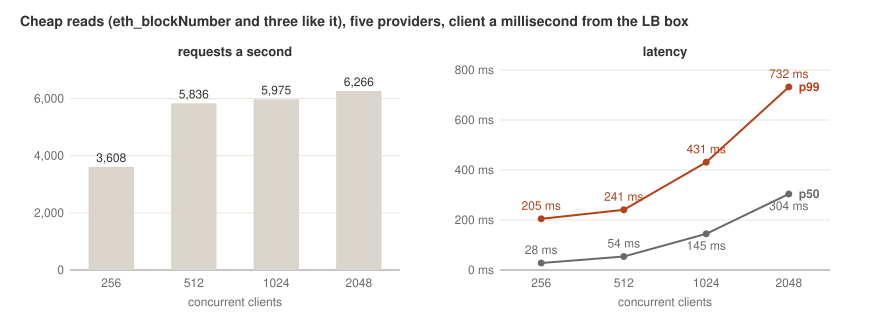
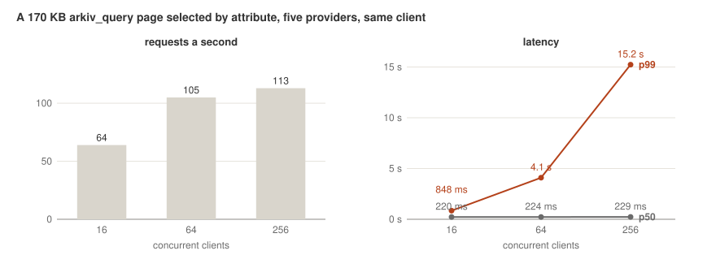
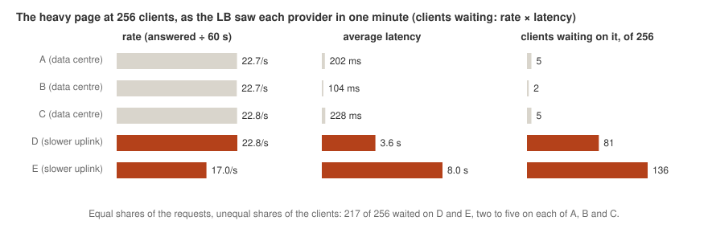
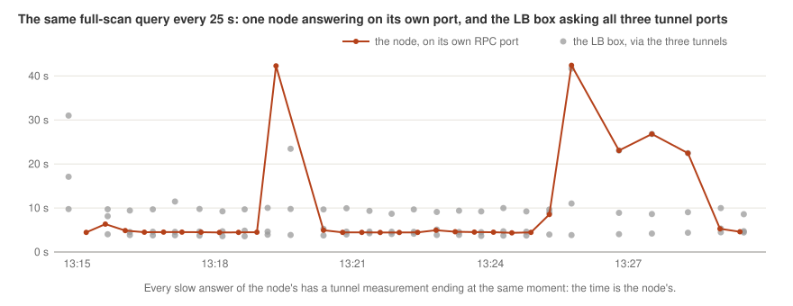
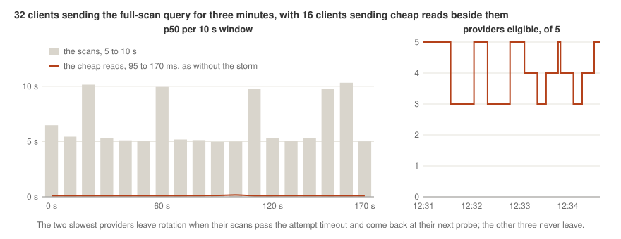

# The load test

What a deployment of this LB serves under load, measured in October
2026 against a running fleet, what gave out first on each kind of
request, and how to run the same test against your own deployment.
The numbers are from one LB box and one fleet; the shapes apply to
any. The generator is the rig's `load` command
([TESTING.md](TESTING.md)); what the results changed is in
[LIMITATIONS.md](LIMITATIONS.md) and the runbook's costs section
([RUNBOOK.md](RUNBOOK.md#what-normal-operation-costs)).

## The findings

- A 2-core LB box serves about 6,000 cheap reads a second through five
  tunneled providers, with latency flat up to 512 concurrent clients.
  The ceiling is the LB box's cores, two thirds of it the kernel moving
  each request across the LB box twice; more cores move it, nothing in
  the LB does.
- Heavy responses (a 170 KB page of entities) top out at about 110 a
  second on this fleet, with the LB box at 10 to 20% CPU. The ceiling
  is the slowest provider's uplink: round-robin gives every provider
  an equal share of the requests and nothing caps what one has in
  flight, so most of the clients end up waiting on the slow
  providers while the fast ones sit idle. A cap on requests in
  flight per provider is the fix
  ([#54](https://github.com/gumb0/arkiv-community-lb/issues/54)).
- Past either ceiling the LB degrades as it should: latency grows
  with the queue, nothing fails, nobody is quarantined.
- One client sending an expensive query on 32 connections slows that
  query to 5 to 25 s for everyone and makes the slowest providers
  flap: their attempts time out, the health logic quarantines them,
  their probes readmit them, and the waiting queries take them out
  again. Cheap reads were not affected. In one run every provider
  went out at once and the endpoint answered `no healthy provider`
  for a while. The LB cannot make the nodes faster; what it must do
  is stop quarantining a provider for being slow while it still
  answers.
- Two findings on the node software, not the LB. An `arkiv_query`
  with a range over every entity (`$expiresAt > u64(0)`) takes a
  node 4 to 10 s per page where a page selected by attribute takes
  0.3 s, and the cost grows with the live set: four days later the
  same page took 46 s on one node and over 120 s on another, with
  cheap reads at a millisecond beside it. And the scan's time jumped
  to 20 to 40 s at times on every node in the same minutes, for a
  reason not found.
- Memory stays at about 100 MiB whatever is in flight.
- Two things broke and were fixed: Docker's default open-files limit
  (1,024) took the whole fleet out at about 500 requests in flight,
  and the 10 s attempt timeout was short for a slow provider's page
  under load (15 s now).

## The setup

- **The LB box:** a 2-core, 4 GB cloud instance running the stack as
  shipped (the LB, the tunnel server, the chain-writer sidecar), with
  `attempt_timeout` at 15 s and `request_timeout` at 30 s.
- **The fleet:** five providers, every one connected through its
  tunnel. Three ran in data centres; two were on slower uplinks (a
  home connection, a budget host). They are A to E below.
- **The client:** a 1 GB instance in the same data centre, a
  millisecond from the LB box, so the latencies measured are the LB
  box's and the fleet's. An earlier pass from a laptop 125 ms away gave the
  same shapes with the laptop's link on top (it capped each client at
  about 8 requests a second and the whole run at about 100 Mbit/s),
  and is what a home client would see.
- **The requests:** `cheap`, four small reads every node answers from
  memory (`eth_blockNumber`, `eth_chainId`, `eth_gasPrice`,
  `net_version`), which cost the node nothing and so measure how
  many requests the LB box can forward a second; and `query`, one
  `arkiv_query` for a full page of 200 entities with their payloads,
  170 KB, selected by one attribute, for the heavy case. Each step
  ran its number of concurrent clients for 60 s, every client sending
  its next request as soon as the answer came back.

## Cheap reads



| Clients | Requests a second | p50 | p99 | Failed |
|---|---|---|---|---|
| 256 | 3,608 | 28 ms | 205 ms | 0 |
| 512 | 5,836 | 54 ms | 241 ms | 0 |
| 1,024 | 5,975 | 145 ms | 431 ms | 0 |
| 2,048 | 6,266 | 304 ms | 732 ms | 0 |

The rate stops growing at about 6,000 a second from 512 clients on.
From there a request's latency is almost all waiting in line: every
client holds one request open, so there are always as many requests
on the LB box as there are clients, served at a fixed rate, and each
one waits clients ÷ rate for its turn (1,024 ÷ 6,000 is 170 ms;
2,048 ÷ 6,266 is 327 ms, close to the p50s measured). All five
providers' latencies as the LB saw them rose together when the
clients doubled, so the queue is before the traffic splits by
provider.

Where the LB box's time went: `docker stats` showed the LB at 70%
and the tunnel server at 55% of the LB box's 200%, which suggested
spare capacity. `top` showed none: idle 0 to 3%, with the kernel at
60 to 75%. That is `sy`, the system calls the LB and frps make on
their sockets, plus `si`, the interrupt handling that moves packets
through the TCP stack and is charged to no process. The LB box was
full, and two thirds of it was the kernel moving each request across
the LB box twice, once on the client's socket and once on the
tunnel's.

So the ceiling for cheap reads is the LB box's cores, at the
networking cost of a request, not the LB's code. More cores move it;
nothing in the LB does. Past the ceiling the LB degrades the way it
should: latency grows with the queue, nothing fails, nobody is
quarantined.

## The heavy page



| Clients | Pages a second | p50 | p99 | Failed |
|---|---|---|---|---|
| 16 | 64 | 220 ms | 848 ms | 0 |
| 64 | 105 | 224 ms | 4.1 s | 0 |
| 256 | 113 | 229 ms | 15.2 s | 0 |

The rate stops at about 110 pages a second from 64 clients on, with
the LB box at 10 to 20% CPU. The p50 does not move: it is the fast
providers' 225 ms throughout. The p99 grows because the clients queue
on the slow providers, as the next chart shows. The p50 hides it only
because the slow providers are two of five: round-robin gives each
the same number of requests, so 40% of the answers were slow and the
median fell in the fast 60%. With three slow providers of five the
p50 would have been seconds too; a p90 shows it in any fleet.



In one minute at 256 clients the LB saw the three data-centre
providers answer in 100 to 230 ms and the two on slower uplinks in
3.6 s and 8 s (the worst single page 11 s). Round-robin gives every
provider the same number of requests whatever its speed, and nothing
limits what one provider has in flight, so the clients sent to a
slow provider wait on it while the fast ones run out of work. (E's
lower rate in the minute is the requests sent to it that it had not
yet answered when the minute ended.)

How many clients each provider held follows by Little's law:
requests in flight = rate × latency, the rate being the requests it
answered in the minute ÷ 60. On average over the minute about 136 of
the 256 clients were waiting on E, 81 on D, and two to five on each
of A, B and C; the remaining 27 or so were in transit or in the LB's
own queue. The fast three sat near idle, and the fleet's rate was
the slow providers' throughput times five: a 30 Mbit/s uplink
carries about 22 pages of 170 KB a second, and five times that is
the 110 measured.

So the ceiling for heavy responses is the slowest provider's uplink,
through round-robin's equal shares. The fix is a cap on requests in
flight per provider, so that a provider at its cap is skipped and
the clients go to providers that are answering
([#54](https://github.com/gumb0/arkiv-community-lb/issues/54)); with
it the fleet's rate becomes the sum of what each provider handles on
its own, the fast ones no longer held back by the slow ones. The
expected check is this same 256-client step: the rate should rise
from 110 toward that sum, with the p99 bounded by the cap times a
slow provider's time per page.

## Memory, and what broke

The LB used about 100 MiB idle and the same with 32 full pages in
flight. It holds nothing beyond the responses passing through it.

Two things broke during the test, both fixed:

- **The open-files limit.** The first 512-client step failed at
  once: nearly every request `lb: no provider answered`, then every
  provider quarantined and `lb: no healthy provider`, and at 1,024
  the LB stopped accepting connections. Docker's default limit of
  1,024 open files was the cause: each request in flight holds two
  sockets, so about 500 in flight exhaust it, every upstream connect
  fails, the failures tick every provider's health, and the accept
  loop logs `Too many open files`. The stack now sets the limit to
  65,536 on the LB and on the tunnel server. The underlying class, an
  LB-local failure counted as the provider's, is
  [#61](https://github.com/gumb0/arkiv-community-lb/issues/61).
- **The attempt timeout.** Under load a page from a slow provider
  took up to 11 s. The default `attempt_timeout` was 10 s, which
  would have failed those requests over and ticked the provider's
  health while it was answering, the start of flapping: an
  overloaded provider quarantined, recovering without traffic,
  readmitted, overloaded again. The default is 15
  s now, half the request timeout so a failover still gets a full
  attempt.

## The full-scan query: what was not the LB

The first heavy run asked for the page with a range over every
entity (`$expiresAt > u64(0)`) instead of by attribute. Through the
LB it was 504s at the request timeout from one client up, and in
that run one node answered nothing within the 15 s attempt timeout
while answering the same query in 4 to 7 s on its own port (later
runs did not repeat this). To find where the time went, the same
query was sent every 25 s for 15 minutes to that node's own RPC port
and, from the LB box, to all three tunnel ports at once:



The node answers in 4.5 s most of the time, and at times in 20 to
40 s, between one measurement and the next. In each of those, the
query on the node's own port and the one through its tunnel were
answered at the same instant, whenever each had been sent: the node
held the scans until something inside it finished, then released
them together. So the time is spent inside the node, not on the way
to it. The other nodes slowed in the same minutes. What causes the
slow minutes, and whether they hold anything but scans, this test
did not establish.

Four days later the same scan took 46 s on one node and over 120 s
on another, both healthy by every other measure, while
`eth_blockNumber` answered in a millisecond beside it. Its cost is
the size of the live set, which the devnet's baseload writes grow
every day; a page selected by attribute stays at a fraction of a
second, steadily, measured over half an hour on an idle node. So,
for the node software: a range over every entity is a walk over
everything live, growing with the chain. The LB was right to report
it as it did.

The method is worth keeping whenever a provider looks slow: the
same query at the node, at its tunnel port on the LB box, and through
the LB, side by side over time. The difference between any two
columns is the hop that takes the time.

## An expensive query storm

A query that costs the node seconds costs the client nothing to
send, so the question is what happens to everyone else while one
client sends many. 32 clients sent the full-scan query for three
minutes while 16 clients sent cheap reads beside them:



On its own a scan took a node 4 to 7 s. With 32 clients sending
them, about six per node at any moment, the p50 was 5 to 10 s, the
p99 25 s, and 16 of 614 ran past the LB's request timeout of 30 s.
The cheap reads did not notice: 110 a second at a p50 of 97 ms and
nothing failed, the same as the 16 clients get without the storm. A node runs cheap reads beside its scans without
delay, and round-robin skips the providers that are out. What the
storm did reach was the health logic: the two slowest nodes passed
the 15 s attempt timeout on their scans, three failed attempts in a
row quarantined each, their cheap probes passed and readmitted them
about 30 s later, the waiting scans hit them again, and so on for
the three minutes (five times each). The other three never left
rotation.

A first run of the same storm, three hours earlier, was worse: all
five providers were quarantined at once 15 s after it began and
flapped together for three minutes, and the LB answered `lb: no
healthy provider` 465 times while none was in rotation. It did not
repeat; the nodes' slow minutes (above) came in clusters of about
that length, which may be what it landed on. What it shows is what
the health logic allows when every node is
slow at the same time: an attempt that times out counts the same as
a refused connection, so a busy fleet becomes an empty one, and the
probes bring it back only to lose it again.

So a storm of expensive queries makes every query of that kind slow
or time out, makes the slow providers flap, and when every node is
slow at once empties the rotation. The LB cannot make the nodes
faster, and it tells neither an expensive request from a cheap one
nor one client from another. What it can do is stop quarantining a
provider for being slow while it is still answering
([#62](https://github.com/gumb0/arkiv-community-lb/issues/62)), so
that a storm costs the queries of its own kind and nothing else.

## Running it again

What you need: a deployment to test (yours, and its providers know a
test is coming), a client machine, and 15 minutes.

1. **A client next to the LB box.** A small instance in the same data
   centre, so the client's link is not what you measure. On it:

   ```
   apt-get update && apt-get install -y build-essential pkg-config libssl-dev git curl
   curl --proto '=https' --tlsv1.2 -sSf https://sh.rustup.rs | sh -s -- -y && . ~/.cargo/env
   git clone https://github.com/gumb0/arkiv-community-lb && cd arkiv-community-lb
   cargo build --release -p rig
   ulimit -n 65536
   ```

   The last line matters: each concurrent client is one connection,
   and the shell's default of 1,024 is below the steps you will run.
   The build is the slow part; the rest takes minutes.

2. **The runs.** Cheap reads in rising steps until the rate stops
   growing, then the heavy page the same way, with a filter that
   selects a full page on your network (a range over every entity
   measures the node's scan, not the forwarding):

   ```
   ./target/release/rig load --target http://<lb-box>:8545 --requests cheap --concurrency 256,512,1024,2048 --duration 60
   ./target/release/rig load --target http://<lb-box>:8545 --requests query --query "<attribute> = str('<value>')" --concurrency 16,64,256 --duration 60
   ```

   Each step prints a line every 10 s with that window's rate, counts
   and latency, a summary per step, and a table at the end (rate,
   p50, p99, failures per step). Failures are reported by kind with
   the first reason seen; a run with any exits nonzero.

3. **On the LB box.** Two things during the runs, in two terminals:

   ```
   docker stats --format "table {{.Name}}\t{{.CPUPerc}}\t{{.MemUsage}}"
   for i in 1 2 3 4 5; do top -bn1 | sed -n 3p; sleep 10; done
   ```

   `docker stats` gives each service's share; `top`'s `%Cpu(s)` line
   gives the whole machine including the kernel's share, which
   `docker stats` leaves out and which is most of the cost. And one
   thing after a step: the LB's own view of each provider in that
   minute, from its per-request log line (the log carries colour
   codes, hence the `sed`):

   ```
   docker logs --since 10m arkiv-community-lb-lb-1 2>&1 | sed 's/\x1b\[[0-9;]*m//g' | grep 'outcome=answered' \
    | sed 's/^\([0-9T:-]*\)[^ ]* .*provider=\([^ ]*\) attempts=[0-9]* latency_ms=\([0-9]*\).*/\1 \2 \3/' \
    | awk '{m=substr($1,12,5); k=m" "substr($2,1,12); n[k]++; s[k]+=$3; if($3>x[k])x[k]=$3} END{for(k in n) printf "%s n=%d avg=%d ms max=%d ms\n", k, n[k], s[k]/n[k], x[k]}' | sort
   ```

   One line per provider per minute: how many it answered, its
   average and worst latency as the LB saw them. Equal counts with
   one average far above the others is a slow provider holding the
   clients; all averages rising together is the LB box.

4. **Reading it.** The rate stops growing at some step; from there
   the p50 is clients ÷ rate if the queue is at the LB box, or stays at
   the fast providers' latency, with the p99 growing, if the queue is
   on a slow provider. If `top` shows little idle, the LB box is the
   limit; if it shows idle while the rate has stopped growing, the
   fleet is. Memory should not move. Any failures, or a provider
   leaving `/nodes` during a run, are a finding, not noise: the
   test's main purpose is to see what the LB does past its limit,
   and the only right answer is that it slows down.

The numbers above are from a two-core LB box and a fleet of five;
expect the cheap-read ceiling to scale with the LB box's cores and
the heavy page's with the providers' uplinks until the per-provider
cap lands.
